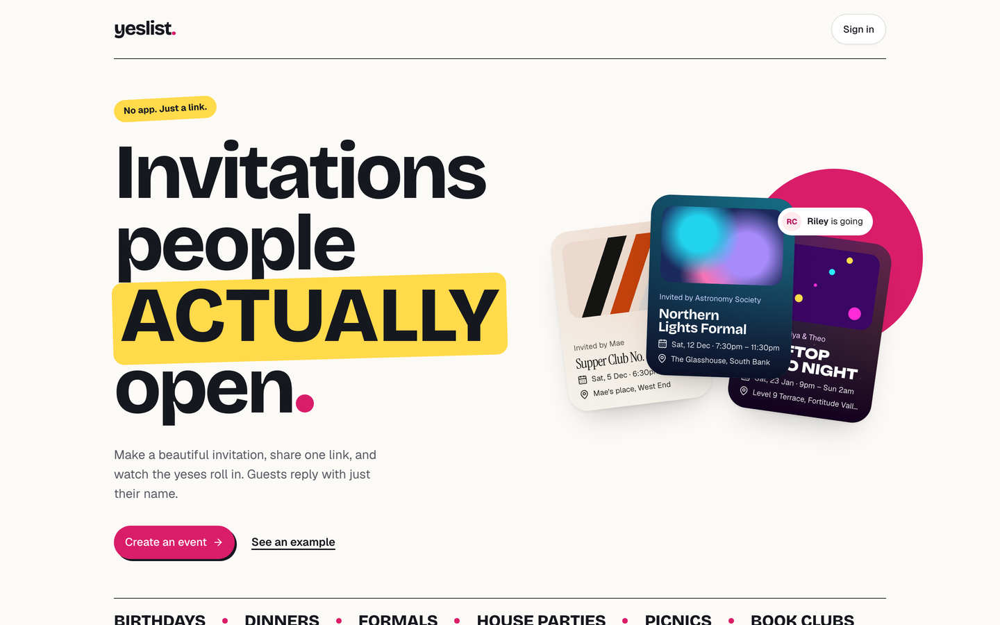
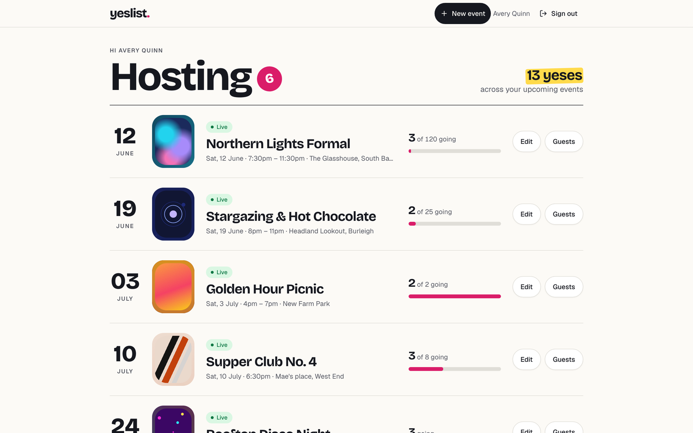
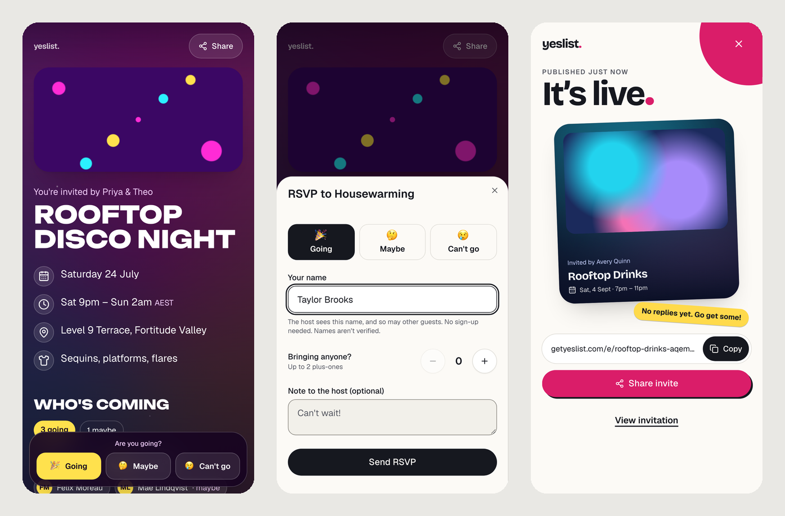
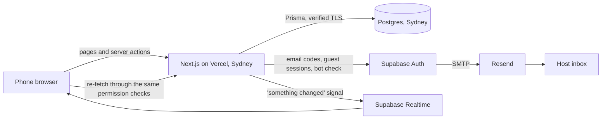

# yeslist.

**Beautiful event invitations that people actually reply to.** A host creates an invitation,
shares one link, and watches the guest list fill up live. Guests reply with just their name: no
app, no account, no password.

> **About this repository.** This is a public **project showcase**: screenshots, architecture and
> engineering notes. The application's source code is maintained in a **private** repository.
> I'm happy to walk through the code in an interview or share access on request.

## Screenshots

**Homepage**

**Host dashboard:** every event at a glance, with replies and capacity

**On a phone:** a guest's invitation, replying with just a name, and the host's "It's live." moment after publishing

_Captured from a local production build with fictional sample data: no real users, events or
tokens. The development sign-in banner, which never appears in production, is hidden._

## What it does

- **Hosts sign in with a 6-digit email code.** There are no passwords. A code also works inside
  chat apps' in-app browsers, where magic links break.
- **A four-step event builder** with five hand-tuned themes and a live preview. It also sets
  capacity, plus-ones, an RSVP deadline and who can see the guest list.
- **Name-only RSVPs:** Going, Maybe or Can't go, plus-ones and a note. Each guest gets an
  anonymous session, so they can change their reply later.
- **Capacity and an automatic waitlist:** when someone drops out, the first waitlisted guest is
  promoted, and their open page updates by itself.
- **Live updates:** the host's guest list updates within about 1–2.6 seconds of a guest replying
  (measured on the hosted staging environment).
- **Private recovery links:** each RSVP gets a link for restoring it on another device. Opening
  the link changes nothing; the guest confirms, and the link then rotates.
- **Three visibility levels:** public, link-only and invite-only. Exact addresses and guest names
  unlock only for the people entitled to them.
- **The "It's live." moment:** after publishing, the host lands on a celebration screen that puts
  sharing first. Invite-only events point to personal invite links instead of the public URL.

## Tech stack

| Concern | Choice |
| --- | --- |
| App | Next.js 16 (App Router, Cache Components), React 19 |
| Language | TypeScript (`strict`, `noUncheckedIndexedAccess`) |
| UI | Tailwind CSS v4, Radix primitives, Motion. A custom design system: Bricolage Grotesque and Geist |
| Data | PostgreSQL on Supabase (Sydney); Prisma 7 with the `pg` driver adapter |
| Auth | Supabase Auth: email one-time codes for hosts, anonymous sessions for guests |
| Bot protection | Cloudflare Turnstile |
| Email | Resend (custom SMTP for sign-in codes) |
| Realtime | Supabase Realtime Broadcast (signal-only messages) |
| Validation | Zod on every external input |
| Testing | Vitest and React Testing Library; Playwright (local, CI and hosted staging); axe-core |
| Hosting and CI | Vercel (functions in Sydney); GitHub Actions |

## Architecture

- **A modular monolith with thin routes.**
  - Pages and server actions parse input with Zod and call a service.
  - Business rules live in pure, unit-tested domain functions (permissions, capacity, time
    zones) and in transactional services.
- **Authorization is server-side and explicit.** Every action resolves the viewer and asks
  `can(context, capability)`. Hiding something in the UI is cosmetic only.
- **Caching without leaking.** Public event pages are cached per event. Anything personal (your
  reply, the address, the guest list) renders per request, so it never enters a shared cache.

## Engineering challenges

**1. No overbooking under concurrency.** Popular events get bursts of replies.
- Each RSVP runs in a database transaction that locks the event row (`SELECT … FOR UPDATE`),
  then checks capacity and the waitlist inside the lock.
- An integration test fires 30 simultaneous RSVPs, with plus-ones, at a 10-seat event and asserts
  the capacity is never exceeded. Another checks that waitlist promotion is first-in, first-out.

**2. Realtime without leaking personal data.**
- The realtime channel never carries names or replies: the server only broadcasts "this event
  changed".
- Each open page then re-fetches what it's allowed to see, through the same authorization as a
  normal page load. Polling is the fallback.
- A guest who has just been promoted off the waitlist sees "You're going" appear on their own
  open page.

**3. Frictionless guests, without opening the door to abuse.**
- Guests get an anonymous session on their first reply. Those sessions can never act as hosts,
  and that's enforced on the server for every host page and action.
- Abuse controls:
  - Postgres-backed rate limits with hashed keys, per IP, per event and per contact;
  - Cloudflare Turnstile on sign-in codes and on guest-session creation.
- Turnstile tokens are single-use, so the app checks one is present and Supabase verifies it.
  Production refuses to start without the bot-check configuration.

**4. Secret links that survive link previews.**
- Invite and recovery links are 256-bit random tokens, stored only as SHA-256 hashes.
- Chat apps and email scanners open URLs automatically, so opening a recovery link never changes
  anything. The guest confirms with **Restore my RSVP**, and the token rotates under the event
  lock (compare-and-set), so a raced restore can only succeed once.

**5. Invite-only privacy everywhere the title could leak.**
- Invite-only events show a generic "You're invited" title, description and link-preview card.
- They're marked `noindex`, and their details are never placed in a shared cache.
- Tests assert this for metadata, previews and anonymous visitors.

**6. Design that doesn't cost guests performance.**
- The brand display font, with its optical-size and width axes, is about 128 KB. It's a separate,
  non-preloaded font used only on host screens.
- Guest invitations keep their theme's existing 40 KB font file, byte-for-byte, and screenshot
  tests show guest pages pixel-identical after the redesign.
- Headlines with decorative caps or a stylised full stop keep their plain-sentence accessible
  names; an end-to-end test asserts this for the homepage headline.

## Quality and testing

| Layer | What it covers | Count |
| --- | --- | --- |
| Unit | Permissions matrix, capacity maths, time zones, config refusals, log redaction, design-token contrast, UI components | 268 |
| Integration | Real Postgres: concurrent RSVPs, waitlist order, isolation between guests, invite and recovery links (including races), rate limits, row-level security | 73 |
| End-to-end | Playwright on a production build at a phone viewport: full journeys, live updates, waitlist promotion, recovery, link previews, 44px touch targets | 25 |
| Bot check | The same build with Cloudflare's test keys: passing and failing CAPTCHA | 3 |
| Hosted staging | Against the deployed staging site with real Supabase: sign-in, live updates, waitlist, recovery, invite-only | 9 |
| Visual and accessibility | Screenshot regression on 19 screens at phone and desktop widths (plus 320 and 375px); axe WCAG 2.2 AA scan on every captured state | 0 violations |

The design system's colour pairs are contrast-tested (WCAG AA) in unit tests. Regression tests for
bugs are first run against the unfixed code, to prove they catch the bug.

## Deployment and release process

| Environment | Builds | Access |
| --- | --- | --- |
| Staging | every branch and pull request | Protected |
| Production | only the `production` branch | Protected until public launch |

1. **Merge** a focused pull request to `main` once CI passes: migrations apply cleanly; type
   checks, lint and formatting; unit, integration, end-to-end and bot-check suites; the production
   build; a dependency audit; and a live database TLS probe.
2. **Staging:** fast-forward the `staging` branch to that exact commit, then run the hosted
   verification suite against real Supabase.
3. **Production:** with explicit approval, fast-forward `production` to **the same commit staging
   verified**. No force pushes, and no unverified commits.

Other safeguards:
- Database migrations never run during builds. They run from manual, confirmation-gated workflows,
  and the production one needs a reviewer.
- Database connections verify the certificate chain and hostname.
- Production refuses to start with development sign-in, test credentials, a missing bot-check key
  or a non-canonical URL.

## Security at a glance

- Server-side authorization on every page and action. Guest sessions can never host.
- Row-level security on every table, with no client policies: the browser never queries the
  database directly.
- Hashed, single-purpose tokens, and `no-referrer` on token links.
- A strict content security policy, HSTS and `frame-ancestors 'none'`.
- Structured logs that redact contact details, codes and tokens.
- No advertising, analytics or tracking.

## Status

Feature-complete for a small public beta; launch-readiness work is under way. The production site
stays private until the launch checklist (including legal pages) is complete.

---

© yeslist. All rights reserved. This showcase repository contains documentation and screenshots
only; it contains no application source code.
